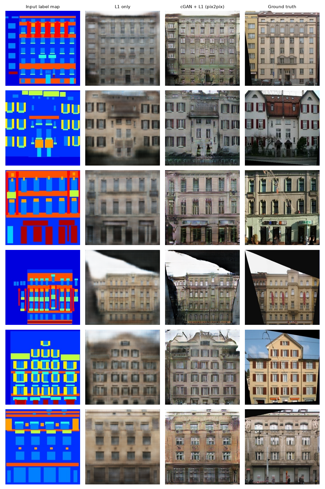
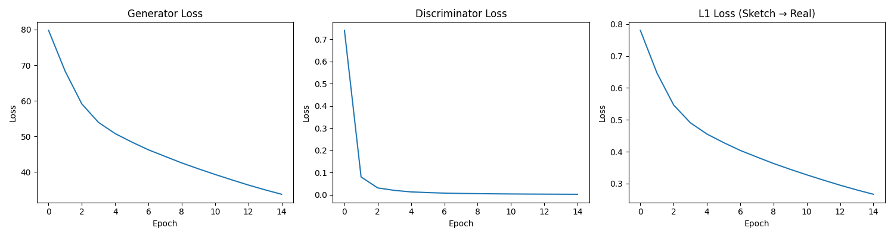

# Pix2Pix: Image-to-Image Translation on CMP Facades

[](https://github.com/HessamKaveh/pix2pix-image-translation/actions/workflows/ci.yml)   [](LICENSE)

A from-scratch PyTorch reimplementation of **pix2pix** (Isola et al., *Image-to-Image Translation with Conditional Adversarial Networks*, CVPR 2017), trained on the real **CMP Facades** dataset to translate architectural label maps into photos. It includes an **L1-only ablation**, which shows what the adversarial loss adds.

<p align="center"></p>

*Unseen test images. Columns: input label map · L1-only generator · pix2pix (cGAN + L1) · ground truth.*

## Results (Facades test split, 106 images, 256×256)

| Model | L1 ↓ | PSNR (dB) ↑ | SSIM ↑ | FID ↓ |
|---|---|---|---|---|
| L1 only (ablation) | **0.171** | **13.27** | **0.305** | 182.5 |
| cGAN + L1 (pix2pix) | 0.183 | 12.49 | 0.232 | **125.6** |

**Reading the table:**
- The L1-only model wins on pixel-wise metrics because it predicts the conditional mean: a blurry average facade that is never far from any plausible answer.
- Adding the PatchGAN discriminator lowers FID by ~57 points. The outputs get sharp window frames, textures and high-frequency detail, so their feature statistics are much closer to real photos.
- This trade-off (slightly worse L1/PSNR, much better realism) matches what the pix2pix paper reports in its loss ablation.

FID is computed with `torch-fidelity` (Inception-v3 pool3) between the 106 generated images and the 106 real test photos. With so few images FID has a high variance, so it is only meaningful for comparing models within this table.

<p align="center"></p>

## Method

| | |
|---|---|
| Generator | U-Net-256: 8 down / 8 up blocks with skip connections; dropout 0.5 in the first 3 decoder blocks (the noise source, also kept at test time) |
| Discriminator | 70×70 PatchGAN, conditioned on the input (6-channel input) |
| Loss | BCE (vanilla GAN) adversarial loss + λ·L1, λ = 100 |
| Optimiser | Adam (lr 2e-4, β = (0.5, 0.999)), batch size 1, 200 epochs (constant for 100, then linear decay to 0) |
| Augmentation | resize to 286 → random crop 256, random horizontal flip |
| Inference | `train()` mode with batch size 1 (dropout on, batch statistics), as in the paper |
| Init | N(0, 0.02) |

Training takes about 90 minutes per model on a laptop RTX 500 Ada (4 GB).

## Dataset

[CMP Facades](https://cmp.felk.cvut.cz/~tylecr1/facade/), in the pix2pix release (400 train / 100 val / 106 test, each image a 512×256 photo|label pair). The direction is **B → A** (label map → photo).

```bash
wget http://efrosgans.eecs.berkeley.edu/pix2pix/datasets/facades.tar.gz
tar xzf facades.tar.gz                 # -> facades/{train,val,test}
export FACADES_ROOT=$PWD/facades
```

## Usage

```bash
pip install -r requirements.txt
python src/train.py --mode gan_l1      # pix2pix (cGAN + L1)
python src/train.py --mode l1          # L1-only ablation
python src/evaluate.py                 # metrics.json, sample grid, training curves
```

## Repository layout

```
src/dataset.py    Facades loader (split, jitter, flip, [-1, 1] normalisation)
src/model.py      U-Net generator, PatchGAN discriminator, weight init
src/train.py      training loop (--mode gan_l1 | l1)
src/evaluate.py   L1 / PSNR / SSIM / FID + figures
results/          metrics.json, training histories, figures
```

## Author
Hessam Kaveh — Research Fellow, Italian Institute of Technology (IIT)

## License

Released under the [MIT License](LICENSE).
